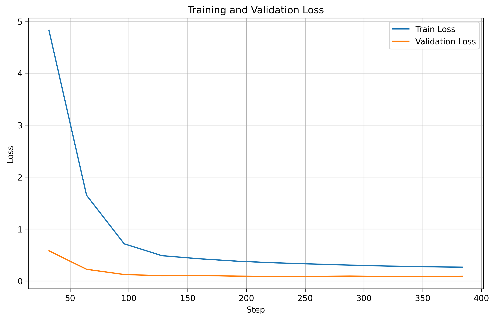
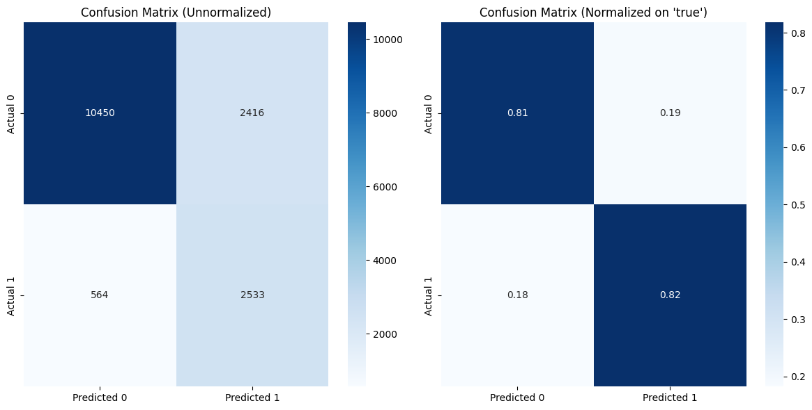
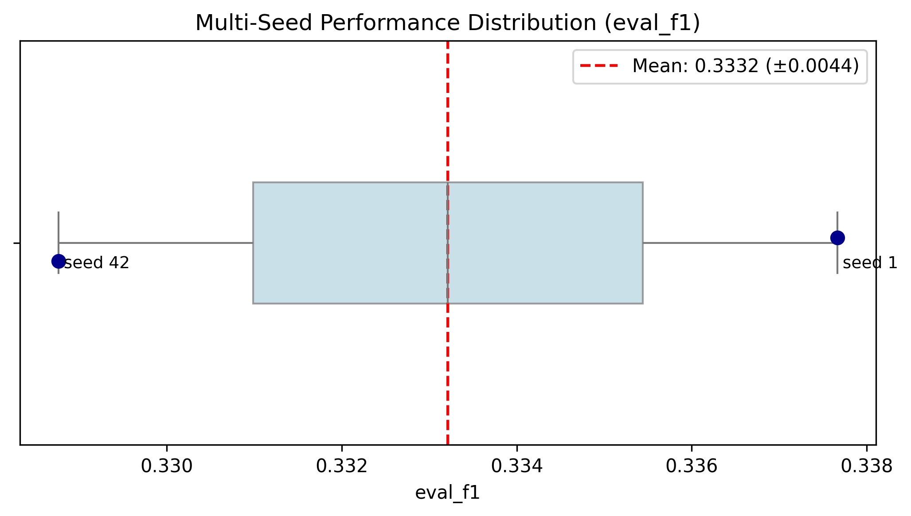

# Biomedical Extraction Pipeline

## Project overview

The core question behind this project is whether relatively compact open LLMs, including 14B-parameter instruct models, can generate useful weak labels for biomedical text data that are strong enough to support downstream relation extraction. Rather than treating the LLM as the final classifier, the project uses it as a weak supervisory signal: it extracts candidate chemical-disease relations, records reasoning traces and weak labels, and then checks whether those labels are informative enough to train a smaller relation-extraction model.

This is intentionally broader than the original BC5CDR binary formulation. The weak-label schema was extended to a four-class setup to capture more clinically meaningful relation types beyond simple presence/absence: no relation, causal induction, treatment/prevention, and antagonism/blocking. In practice, the additional classes are much rarer than the main positive/negative split, so the project explicitly evaluates how much signal remains useful in sparse multiclass settings.

## Contents

```text
.
├── data/
│   ├── checkpoints/
│   └── processed/
├── evals/
│   ├── images/
│   └── tables/
├── logs/
├── notebooks/
│   ├── 01_data_prep.ipynb
│   ├── 02_ner_training.ipynb
│   ├── 03_weak_supervision.ipynb
│   ├── 04_re_eval.ipynb
│   ├── 04_re_training.ipynb
│   ├── 05_xai.ipynb
│   └── kaggle/
├── requirements/
│   ├── core.in
│   ├── data_prep.in
│   ├── transformer_training.in
│   ├── weak_supervision.in
│   ├── xai.in
│   ├── locks/
│   ├── snapshots/
│   └── kaggle/
├── results/
│   ├── ner/
│   └── re/
├── src/
│   ├── __init__.py
│   ├── config.py
│   ├── utils.py
│   ├── data_utils/
│   │   └── preprocessing.py
│   ├── evaluation/
│   │   └── diagnostics.py
│   ├── explainable_ai/
│   │   └── shap_xai.py
│   ├── modelling/
│   │   ├── __init__.py
│   │   ├── eval.py
│   │   ├── named_entity_recognition.py
│   │   ├── relation_extraction.py
│   │   └── training.py
│   └── structured_extraction/
│       ├── __init__.py
│       ├── generator.py
│       ├── prompts.py
│       └── pydantic_schema.py
├── scripts/
│   └── make_diagnostic_set.py
├── .python-version
├── .gitignore
├── README.md
└── LICENSE
```


## Getting started

1. Create a Python environment.
2. Install a target-specific lock file from `requirements/locks/` (see [Dependency management](#dependency-management)).
3. Use the notebooks in `notebooks/` to run data preparation, training, and evaluation.

## Dependency management

The `requirements/` directory separates dependency inputs, reproducible lock files, and records of environments used for notebook runs:

- **`.in` files** are the maintained dependency inputs. They list direct dependencies and may include shared inputs such as `core.in`. For example, `transformer_training.in` defines the dependencies shared by NER and relation-model training.
- **`locks/`** contains generated, fully pinned `.txt` files for a specific Python version and platform. Install the matching lock file for your environment, for example:
  ```bash
  uv pip install -r requirements/locks/transformer_training-colab-py312-linux.txt
  ```
  Regenerate a Colab Python 3.12 Linux lock from the project root with:
  ```bash
  uv pip compile requirements/transformer_training.in \
    -o requirements/locks/transformer_training-colab-py312-linux.txt \
    --python-version 3.12 --python-platform linux
  ```
- **`snapshots/`** contains `pip freeze` captures from notebook environments. These are historical records for inspection, not the maintained dependency inputs; use the corresponding lock file for installs.
- **`kaggle/`** holds the Kaggle-specific weak-supervision requirements file.

## Notebook Guides

### Notebook 01: Data Preparation (`notebooks/01_data_prep.ipynb`)

This notebook handles data loading and preprocessing for the biomedical extraction pipeline.

**Dataset:** [bigbio/BC5CDR](https://huggingface.co/datasets/bigbio/bc5cdr)
- **Description:** BC5CDR (BioCreative V Chemical Disease Relation) is a benchmark biomedical dataset containing PubMed abstracts annotated with chemical and disease entities, as well as their relationships.
- **Task:** Named Entity Recognition (NER) for Chemical and Disease entities in biomedical text
- **Splits:** Train, Validation, Test
- **Annotations:** BIO-tagged entity labels (B-Chemical, I-Chemical, B-Disease, I-Disease, O)

**Key Steps:**
1. Load the BC5CDR dataset from Hugging Face (`bigbio/bc5cdr`)
2. Ensure proper train/validation/test splits
3. Flatten nested dataset structure for token classification
4. Save processed dataset to `data/processed/bc5cdr_flattened/`

**Output:** Flattened HuggingFace Arrow datasets ready for model training

---

### Notebook 02: NER Training (`notebooks/02_ner_training.ipynb`)

This notebook fine-tunes a biomedical BERT model for Named Entity Recognition using LoRA (Low-Rank Adaptation).

**Base Model:** [microsoft/BiomedNLP-BiomedBERT-base-uncased-abstract](https://huggingface.co/microsoft/BiomedNLP-BiomedBERT-base-uncased-abstract)

#### Training Configuration

**Model & LoRA Setup:**
```python
peft_config = LoraConfig(
    task_type=TaskType.TOKEN_CLS,
    r=16,
    lora_alpha=32,
    lora_dropout=0.1,
    target_modules=["query", "value"],
)
```

**Training Hyperparameters:**
```python
training_args = TrainingArguments(
    num_train_epochs=20,
    bf16=torch.cuda.is_bf16_supported(),
    fp16=not torch.cuda.is_bf16_supported(),
    per_device_train_batch_size=4,
    per_device_eval_batch_size=4,
    gradient_accumulation_steps=4,
    eval_accumulation_steps=4,
    weight_decay=0.01,
    warmup_steps=20,
    lr_scheduler_type="linear",
    seed=42,
    learning_rate=2e-4,
    eval_strategy="epoch",
    save_strategy="epoch",
    logging_strategy="epoch",
    load_best_model_at_end=True,
    metric_for_best_model="f1",
    greater_is_better=True,
    save_total_limit=1,
    ...
)
```

**Evaluation Strategy:** Per epoch
- Metrics: Precision, Recall, F1, Accuracy
- Best Model Selection: F1 score

#### Training Results

| Epoch | Train Loss | Val Loss | Precision | Recall | F1     | Accuracy |
|:-----:|:----------:|:--------:|:---------:|:------:|:------:|:--------:|
| 1.0   | 4.8229     | 0.5813   | 0.0000    | 0.0000 | 0.0000 | 0.8512   |
| 2.0   | 1.6490     | 0.2256   | 0.6473    | 0.7036 | 0.6743 | 0.9412   |
| 3.0   | 0.7159     | 0.1249   | 0.7722    | 0.8330 | 0.8014 | 0.9623   |
| 4.0   | 0.4875     | 0.1023   | 0.8300    | 0.8143 | 0.8221 | 0.9662   |
| 5.0   | 0.4277     | 0.1060   | 0.7734    | 0.8805 | 0.8235 | 0.9641   |
| 6.0   | 0.3815     | 0.0938   | 0.8272    | 0.8455 | 0.8363 | 0.9677   |
| 7.0   | 0.3503     | 0.0884   | 0.8196    | 0.8745 | 0.8462 | 0.9697   |
| 8.0   | 0.3272     | 0.0896   | 0.8205    | 0.8764 | 0.8476 | 0.9696   |
| 9.0   | 0.3057     | 0.0943   | 0.7938    | 0.8897 | 0.8390 | 0.9674   |
| 10.0* | 0.2877     | 0.0882   | 0.8214    | 0.8803 | 0.8498 | 0.9697   |
| 11.0  | 0.2747     | 0.0873   | 0.8202    | 0.8770 | 0.8476 | 0.9697   |
| 12.0  | 0.2659     | 0.0920   | 0.8043    | 0.8868 | 0.8435 | 0.9684   |

*Best model selected at epoch 10

#### Training Visualizations

<a href="https://Francesco-A-nlp-tracking.hf.space/?project=Biomed-IE&run_ids=24e46632c1b24a9a9a48de8f8e84526b&sidebar=hidden&navbar=hidden" target="_blank"></a>


<details>
<summary>📊 Training Loss Curve</summary>



</details>


#### Model Artifacts

**Fine-tuned Model:** [Francesco-A/BiomedNLP-BiomedBERT-base-uncased-ner-abstract-bc5cdr-LoRA-v1.1](https://huggingface.co/Francesco-A/BiomedNLP-BiomedBERT-base-uncased-ner-abstract-bc5cdr-LoRA-v1.1)

The trained adapter weights and tokenizer are stored on Hugging Face Model Hub with full configuration and label mappings.

---
### Notebook 03: Weak supervision (`notebooks/03_weak_supervision.ipynb`)

This notebook builds the weakly supervised structured extraction stage for the biomedical relation pipeline. It starts from the flattened BC5CDR token-classification dataset and the pair-level relation tables, then generates candidate chemical-disease extractions with a local LLM pipeline that records both the reasoning trace and a weak label.

#### What the notebook does

- loads the processed text dataset and the relation reference data from the project data bundle,
- creates a `pair_id` for each chemical-disease pair,
- iterates over the train/validation/test splits,
- runs the structured extraction call via `get_response(...)` using `SYSTEM_PROMPT`,
- stores intermediate parquet checkpoints and compresses the final weak supervision outputs into a dataset for downstream use.

#### Execution setup

The notebook was designed to run in both Colab and Kaggle. It checks whether it is running on Kaggle, clones the project if needed, and uses Kaggle-mounted input paths such as `/kaggle/input/datasets/USERNAME/biomed-ie-distill-xai/` when available. In the final version, this workflow was executed on Kaggle using a Tesla T4 x2 accelerator setup.

#### Model and backend configuration

The notebook uses a local LLM backend through `llama_cpp`, with GPU offload explicitly validated using `llama_cpp.llama_supports_gpu_offload()`. The main processing call is configured with:

```python
structured_df = get_response(
    id_col="document_id",
    text_col="text",
    instruction=SYSTEM_PROMPT,
    model_checkpoint=model,
    model_source="llama_cpp",
    df_to_structure=flattened_dataset,
    df_exploded_reference=relationship_dataset,
    structured_checkpoint_file_path=structured_checkpoint_file_path,
    checkpoint_steps=15,
    n_rows_to_process=250,
    dataset_split=split,
    smoke_test=smoke_test,
    recovery_mode=recovery_mode,
    verbose=True,
)
```

The notebook keeps `smoke_test=False` and `recovery_mode=False` in the full run, and it saves structured output snapshots after each split.

#### Output format

The resulting dataset keeps the weak-supervision fields needed downstream, including:

- `document_id`
- `pair_id`
- `chain_of_thought`
- `weak_label`
- `extraction_status`
- `__index_level_0__`

This makes it suitable for later labeling, filtering, and relation-model training workflows.

#### Dependencies and artifacts

The notebook uses the weak-supervision lock in `requirements/locks/weak_supervision-colab-py312-linux.txt`, with a Kaggle-specific variant in `requirements/kaggle/03_weak_supervision_kaggle.txt`. The environment was also frozen into snapshots:

- `requirements/snapshots/03_weak_supervision.txt`
- `requirements/snapshots/03_weak_supervision_kaggle.txt`

This notebook is the bridge between the cleaned biomedical dataset and the structured extraction artifacts used in later relation experiments.

---

### Notebook 04a: Relation Extraction training (`notebooks/04_re_training.ipynb`)

This notebook trains the relation-extraction classifier on top of the weakly labeled chemical-disease pairs generated in the previous stage. It merges the structured extraction outputs with the gold relation metadata, normalizes the label schema, and fine-tunes a biomedical Longformer model with LoRA for binary or multiclass relation classification.

#### What the notebook does

- initializes the project in either Kaggle or Colab, including the GitHub/Kaggle dataset setup,
- loads the flattened text data plus the relation reference set and structured weak labels,
- merges pair-level weak labels with the gold relation annotations via `merge_datasets_on_key(...)`,
- applies binary label alignment when `config.model.re_classification_mode = 'binary'`, collapsing higher labels into a positive/negative scheme,
- tokenizes `masked_text` inputs for sequence classification,
- trains LoRA adapters with early stopping and evaluation on validation data,
- saves model checkpoints and zipped training outputs for Kaggle runs.

#### Training configuration

The notebook uses a Longformer-based encoder for sequence classification, with LoRA adapters configured as:

```python
peft_config = LoraConfig(
    task_type=TaskType.SEQ_CLS,
    r=16,
    lora_alpha=32,
    lora_dropout=0.1,
    target_modules="all-linear",
)
```

and training settings including:

```python
baseline_training_args = TrainingArguments(
    num_train_epochs=10,
    per_device_train_batch_size=8,
    per_device_eval_batch_size=8,
    gradient_accumulation_steps=2,
    learning_rate=3e-4,
    lr_scheduler_type='cosine',
    warmup_steps=0.05,
    weight_decay=0.01,
    eval_strategy='epoch',
    save_strategy='epoch',
    load_best_model_at_end=True,
    metric_for_best_model='f1',
    greater_is_better=True,
)
```

The training loop also evaluates multiple seeds (`1`, `42`, `123`) and uses `EarlyStoppingCallback` to stop when performance stalls.

#### Weak-vs-gold label workflow

A key part of the notebook is the quality check between weak supervision labels and the gold labels. It computes a classification report and confusion matrix before training, which helps validate whether the weak labels are reliable enough for model optimization.

The notebook specifically supports both:
- binary alignment mode: `re_classification_mode = 'binary'`
- multiclass mode: `re_classification_mode = 'multiclass'`

and dynamically chooses the target label column as:

```python
label_column = "gold_label" if config.env.gold_baseline else "weak_label"
```

This lets the project compare a gold baseline against the weak-supervision-driven training pipeline.

#### Generated evaluation artifacts

The notebook saves the label quality checks and training diagnostics into the evaluation folders:

- `evals/tables/gen_classification_report_qwen2.5-14b-instruct-gguf.csv`
- `evals/tables/gen_confusion_matrix_qwen2.5-14b-instruct-gguf.csv`
- `evals/images/gen_confusion_matrix_qwen2.5-14b-instruct-gguf.png`

These artifacts are useful for reviewing label agreement, misclassification patterns, and downstream model behavior. The confusion matrix below compares the gold relation labels against the weak labels generated during the weak-supervision stage.

<div align="center">
  
</div>


#### Model outputs and checkpoints

<a href="https://Francesco-A-nlp-tracking.hf.space/?project=Biomed-IE&run_ids=ba7221e214f24f6e81b9ac323cfd9466%2C1d3456640959472d8b56d99a6030915d%2C1a2f99344ed2462fbb9daa3b41163d3b%2Ce9d9c6fa39ed4589bd084f4a6b91647f&sidebar=hidden&navbar=hidden" target="_blank"></a>


The training notebook writes checkpoints under the relation results folders, with model names following the pattern:

- `Clinical-Longformer-re-abstract-bc5cdr-LoRA-v1.1-gold-seed42`
- `Clinical-Longformer-re-abstract-bc5cdr-LoRA-v1.2-qwen2.5-14b-instruct-gguf-binary-seed1`
- `Clinical-Longformer-re-abstract-bc5cdr-LoRA-v1.2-qwen2.5-14b-instruct-gguf-binary-seed42`
- `Clinical-Longformer-re-abstract-bc5cdr-LoRA-v1.2-qwen2.5-14b-instruct-gguf-binary-seed123`
- `Clinical-Longformer-re-abstract-bc5cdr-LoRA-v1.2-qwen2.5-14b-instruct-gguf-multiclass-seed42`

When running on Kaggle, the notebook also zips the output directory to `/kaggle/working/results.zip` so the training artifacts can be downloaded directly after the run.

#### Dependencies and snapshots

The relation training stage uses the transformer-training lock:

- `requirements/locks/transformer_training-colab-py312-linux.txt`

and saves the environment snapshot to:

- `requirements/snapshots/04_re_training.txt`

This notebook is the core training step that turns the weakly supervised pair labels into a usable biomedical relation model.

---

### Notebook 04b: Relation Extraction eval (`notebooks/04_re_eval.ipynb`)

This notebook evaluates the best relation-extraction run produced by the training notebook. It aggregates the seed-level runs, loads the best trainer checkpoint using the validation `eval_f1` metric, and then computes the final test metrics under the selected decision threshold.

#### What the notebook does

- loads the saved training artifacts from the relation output directories,
- aggregates seed results and selects the best run automatically,
- re-tokenizes the train/validation/test data with the saved model configuration,
- searches for the optimal probability threshold on the validation set,
- evaluates the test set at both the default threshold and the tuned threshold,
- outputs binary or multiclass summaries depending on the label configuration,
- saves diagnostic reports and score-distribution plots for downstream analysis.

#### Threshold tuning and evaluation flow

The notebook uses the validation set to estimate the best decision boundary:

```python
output_validation = best_trainer.predict(tokenized_dataset["validation"])
val_probs = softmax(output_validation.predictions, axis=-1)[:, 1]
best_threshold = find_optimal_threshold(val_probs, tokenized_dataset["validation"]["weak_label"])
```

This threshold is then used to compare:

- default threshold metrics at `0.5`
- tuned threshold metrics at the optimal value

For multiclass settings (`config.model.re_classification_mode = 'multiclass'`), it instead reports the class-wise classification summary using `classification_report(...)`.

#### Generated evaluation artifacts

The evaluation notebook produces CSV summaries and score visualizations such as:

- `evals/tables/re_test_results_comparison_qwen2.5-14b-instruct-gguf-binary.csv`
- `evals/tables/re_test_results_disaggregated_qwen2.5-14b-instruct-gguf-binary.csv`
- `evals/tables/re_test_results_disaggregated_qwen2.5-14b-instruct-gguf-multiclass.csv`
- `evals/images/re_score_distribution.png`

These files are helpful for understanding model-quality trade-offs, threshold sensitivity, and class-wise behavior on the evaluation split. The score-distribution plot shown below is specifically the distribution of F1 scores for the binary classifier across three seeds, which helps assess robustness beyond a single training run.

<div align="center">
    
</div>

#### Model Artifacts

The saved checkpoints and adapter configurations are stored in `results/re/` for the local training runs. These directories are ignored by Git as large, generated artifacts. 

#### Notes on the final evaluation

This notebook closes the loop on the relation-extraction pipeline: the best trained model is selected, the decision boundary is calibrated on validation data, and the final performance is summarized on the held-out test set using the same protocol as the rest of the project.

---

### Notebook 05: End-to-end diagnostics and explainability (`notebooks/05_xai.ipynb`)

This notebook evaluates the end-to-end extraction pipeline on a small, manually constructed diagnostic set and generates token-level explanations for the relation classifier. Unlike the relation-extraction evaluation in Notebook 04b, it starts from raw text and runs both named entity recognition (NER) and relation classification.

#### What the notebook does

- loads the diagnostic examples from [`data/diagnostic_set.csv`](data/diagnostic_set.csv), generating the file with [`scripts/make_diagnostic_set.py`](scripts/make_diagnostic_set.py) if it is missing,
- loads the latest NER checkpoint and the best saved binary or multiclass relation-extraction run,
- extracts chemical and disease entities, constructs candidate pairs, and predicts a relation for each pair,
- matches the generated candidate pairs against the manually specified diagnostic targets and compares predictions with the expected labels,
- generates token-level explanations for selected relation predictions using [`transformers-interpret`](https://github.com/cdpierse/transformers-interpret).

#### Diagnostic evaluation

The diagnostic set is designed to probe specific pipeline behaviours, including negation, uncertainty, temporal association, treatment, antagonism, multiple entity pairs, and information spread across sentences. The notebook saves the candidate-pair predictions and target-pair matches to mode-specific CSV files:

- Binary: [`diagnostic_results_binary.csv`](evals/tables/diagnostic_results_binary.csv)
- Multiclass: [`diagnostic_results_multiclass.csv`](evals/tables/diagnostic_results_multiclass.csv)

These are small, targeted diagnostic checks rather than estimates of general performance on biomedical text. Classification is assessed on successfully extracted target pairs, while entity-extraction failures are recorded separately. Other generated candidate pairs are retained for qualitative inspection.

#### Token-level explanations

The notebook generates token-attribution visualizations for selected relation predictions in each mode. The highlighted tokens indicate their contribution to the model's selected prediction and support qualitative inspection; they should not be interpreted as causal feature importance or as evidence of model behaviour across the full dataset.

- [Binary relation explanation](evals/images/xai/transformers-interpret/transformers-interpret_viz_binary.png)
- [Multiclass relation explanation](evals/images/xai/transformers-interpret/transformers-interpret_viz_multiclass.png)

The notebook uses the XAI lock in `requirements/locks/xai-colab-py312-linux.txt` and records the environment snapshot in `requirements/snapshots/05_xai.txt`.

#### Qualitative SHAP results

The PNG filenames use the format `ExPy`, where `x` is the expected label and `y` is the model's predicted label. Thus, matching values indicate a correct prediction, while different values indicate an error. In the binary examples, class 0 means no relation and class 1 means a relation. In the multiclass examples, class 1 is causation, class 2 is treatment/prevention, and class 3 is antagonism/reversal.

These are individual examples, not aggregate evidence of model behaviour. The token values below are the local attribution values shown when inspecting the HTML explanations; they help identify which words influenced each prediction, but should not be interpreted as causal effects or general feature importance.

**Binary model**

- **False positive (`E0P1`):** [shap-id7-E0P1.png](evals/images/xai/shap/binary/shap-id7-E0P1.png). In “Amoxicillin did not cause a rash,” the negation tokens `did` (-0.41) and `not` (-0.495) oppose a positive relation prediction, but `cause` (+0.997) and the disease mention `rash` (+0.19) contribute toward it. This illustrates how a strong causal phrase can outweigh an explicit negation.
- **Correct positive (`E1P1`):** [shap-id8-E1P1.png](evals/images/xai/shap/binary/shap-id8-E1P1.png). For “Naloxone reversed the respiratory depression caused by morphine,” `caused` (+3.094) and `by` (+1.258) are prominent positive cues, while `reversed` (-0.207) and the disease tokens `respiratory` (-0.468) and `depression` (-0.821) push the other way. The model still predicts a relation.
- **False positive (`E0P1`):** [shap-id9-E0P1.png](evals/images/xai/shap/binary/shap-id9-E0P1.png). In “The patient received naloxone, but no respiratory depression was observed,” `naloxone` (+1.023) supports the positive prediction, while `no` (-1.09) opposes it. The error suggests that the model does not consistently let explicit absence override the drug mention and surrounding context.

**Multiclass model**

- **Correct causation (`E1P1`):** [shap-id2-E1P1.png](evals/images/xai/shap/multiclass/shap-id2-E1P1.png). In the sentence about respiratory depression caused by morphine, `caused` (+12.152) is the dominant cue for the predicted causal relation.
- **Correct treatment (`E2P2`):** [shap-id6-E2P2.png](evals/images/xai/shap/multiclass/shap-id6-E2P2.png). In “Ibuprofen relieved the patient's headache,” `relieved` (+9.307) strongly supports the treatment/prevention prediction.
- **Treatment predicted instead of antagonism (`E3P2`):** [shap-id12-E3P2.png](evals/images/xai/shap/multiclass/shap-id12-E3P2.png). Although the sentence says naloxone `counter` (+3.517) `acted` (+3.775) against respiratory depression, the model predicts class 2 (treatment/prevention) instead of class 3 (antagonism). It appears to recognize the intervention but does not distinguish the reversal relation correctly.
- **Treatment predicted instead of antagonism (`E3P2`):** [shap-id13-E3P2.png](evals/images/xai/shap/multiclass/shap-id13-E3P2.png). Here `reversed` (+7.799) is a strong cue, yet the prediction is again treatment/prevention rather than antagonism. Together, these two errors show that the model struggles to separate active reversal from treatment, even when reversal language is prominent.

---

## Overall results and takeaways

This project was designed to answer a concrete question: can a relatively compact 14B-parameter open LLM generate weak labels for biomedical text that are useful enough to train a downstream relation-extraction model? The answer is broadly yes, with an important caveat: the labels are useful, but they are not perfect and they work best as a scalable bootstrap signal rather than as final clinical annotations.

### What was achieved

- A complete weak-supervision pipeline was implemented: biomedical text was processed, chemical-disease pairs were enumerated, candidate relations were scored, and weak labels were stored alongside model-generated rationales.
- The weak-label workflow was then used to train a biomedical Longformer relation model with LoRA. The best weak-label training run reached roughly `F1 ≈ 0.74` on validation, compared with roughly `F1 ≈ 0.59` for the gold-label baseline in the same training setup.
- The original BC5CDR binary framing was expanded into a richer four-class schema to capture clinically more meaningful relation types beyond a simple positive/negative decision.
- The workflow covers weak labeling, gold-vs-weak sanity checks, model training, threshold tuning, and final evaluation.

### Main quantitative signal and evaluation breakdown

The evaluation workflow separates validation (used for early stopping and threshold tuning) from the final held-out test set (used for unbiased performance reporting).

#### Weak-vs-Gold Label Agreement (Binary)

Comparing the LLM-generated weak labels against the gold annotations on the dataset yields:

* **Accuracy**: `≈ 0.81`
* **Positive Class Recall**: `≈ 0.82` (indicating strong coverage of actual positive relation pairs)
* **Positive Class F1**: `≈ 0.63` (reflecting some false-positive noise introduced by the weak annotator)

The relatively lower F1 should be interpreted with some caution, as the weak-labeling scheme does not necessarily follow the same annotation conventions as the BC5CDR gold labels. In particular, differences in how relation instances are formatted and delimited can produce apparent disagreements even when the underlying relation is captured. Thus, the comparison provides a useful indication of label quality, but should not be treated as a direct measure of semantic agreement between the two annotation schemes.

#### Manual review of weak-label disagreements

Agreement with gold annotations provides an important measure of weak-label quality, but disagreements do not necessarily indicate annotation errors by the LLM. In biomedical relation extraction, a model may identify a chemical–disease relation that is supported by the abstract but absent from the gold annotations. To investigate this possibility, I manually reviewed a sample of 50 cases in which the gold label was negative (`gold_label = 0`) and the weak label was positive (`weak_label = 1`).

The reviewed cases are available in [`gen_error_analysis_qwen2.5-14b-instruct-gguf.xlsx`](evals/tables/gen_error_analysis_qwen2.5-14b-instruct-gguf.xlsx). Due to copyright restrictions, the artifact does not include the source text column; relevant identifiers and label/bucket information remain available for traceable review.

The cases were divided into two categories:

- **Bucket A – Text-supported candidate omissions (74%, 37 cases):** the abstract contained textual evidence supporting the chemical–disease relation identified by the LLM, although the corresponding relation was not annotated in the gold data. This may indicate that the gold annotation missed a relation, but it may also reflect stricter annotation criteria under the original dataset's guidelines.
- **Bucket B – LLM failures (26%, 13 cases):** the abstract did not provide sufficient evidence for the relation predicted by the LLM, or the prediction reflected a misinterpretation of the text. These cases represent genuine weak-annotation errors, including instances where the model inferred a relation from contextual co-occurrence or misinterpreted the relationship between the chemical and disease.

The results qualify the interpretation of aggregate weak-label agreement scores. In this reviewed sample, nearly three-quarters of the disagreements involved relations for which textual support could be identified. Consequently, treating every disagreement as an LLM error could underestimate the quality of the weak annotations and overlook potential differences between the annotation criteria applied by the LLM and those used to construct the gold dataset.

At the same time, textual support does not automatically establish that a relation satisfies the original dataset's annotation criteria. The manual assessment therefore distinguishes text-supported candidate omissions from clear LLM failures without claiming to establish whether the original gold annotations were incorrect.

The review should be interpreted as a qualitative assessment of a limited, selectively sampled set of disagreements, rather than as an estimate of the overall proportion of annotation errors in either the gold data or the LLM-generated annotations. It nevertheless illustrates why disagreement-based evaluation alone can provide an incomplete picture of weak-label quality and why manually inspecting disagreements can be informative.

#### Downstream Relation Extraction Test Results (Binary Setting)
After training the Clinical-Longformer model on the weak supervision labels, evaluating on the held-out test set at the default threshold (`0.5`) versus the validation-tuned threshold (`0.5550`) shows robust performance:

| Metric | Threshold (default: 0.5) | Threshold (tuned: 0.5550) |
| :--- | :---: | :---: |
| **Accuracy** | 0.8140 | **0.8157** |
| **Precision** | 0.6570 | **0.6611** |
| **Recall** | **0.8176** | 0.8133 |
| **F1** | 0.7286 | **0.7293** |

Disaggregating the binary test results by class at the optimal threshold:
- **Class 0 (Negative / No Relation)**: Precision = `0.9087`, Recall = `0.8168`, F1 = `0.8603`
- **Class 1 (Positive Relation)**: Precision = `0.6611`, Recall = `0.8133`, F1 = `0.7293`

### Multiclass extension: promising but harder

The expanded multiclass setup goes beyond the original BC5CDR binary objective and is one of the most interesting parts of this work. The schema distinguishes between:

- no direct relation,
- causal/inducing effect,
- treatment/prevention,
- antagonism/blocking.

The multiclass evaluation reached roughly `accuracy ≈ 0.72` and `macro F1 ≈ 0.56`. That is respectable for an expanded label taxonomy, but it also makes the main limitation obvious: the additional classes are much rarer than the main positive/negative split, and the minority classes suffer from sparse support.

The held-out test results by class show the trade-off clearly:

| Class | Relation type | Precision | Recall | F1 | Support |
|:---:|:---|---:|---:|---:|---:|
| 0 | No relation | 0.796 | 0.756 | 0.775 | 2,996 |
| 1 | Causation / adverse effect | 0.671 | 0.754 | 0.710 | 1,612 |
| 2 | Treatment / prevention | 0.510 | 0.483 | 0.496 | 573 |
| 3 | Active antagonism / reversal | 0.282 | 0.222 | 0.249 | 99 |

Across all 5,280 test examples, accuracy is `0.716`, macro F1 is `0.558`, and weighted F1 is `0.715`. The class supports make the imbalance concrete: class 3 has only 99 examples, compared with 2,996 for class 0.

The results highlight the cost of expanding the label space under severe class imbalance. The multiclass extension is more clinically expressive, but the rarest categories remain difficult to learn reliably and would benefit from additional data or a more curated label policy.

### End-to-end diagnostic evaluation

In addition to the held-out test evaluation, I conducted a small, manually constructed diagnostic evaluation to examine the behaviour of the complete pipeline (see [`notebooks/05_xai.ipynb`](notebooks/05_xai.ipynb)). Unlike the held-out test results, which assess relation extraction using the gold entity spans supplied by BC5CDR, this evaluation starts from raw text and therefore tests the interaction between named entity recognition (NER), candidate-pair generation, and relation classification.

The [diagnostic set](data/diagnostic_set.csv) (generated with [`make_diagnostic_set.py`](scripts/make_diagnostic_set.py)) consists of 22 sentences designed to expose potential weaknesses under controlled conditions. The examples cover several challenges, including negation, uncertainty, temporal association, treatment and prevention, antagonistic relations, multiple chemical–disease pairs, and information distributed across sentences. The objective is not to estimate performance on a representative sample of biomedical text, but to identify specific strengths and failure modes that may otherwise remain difficult to isolate in aggregate test results.

#### Entity extraction and candidate-pair generation

The NER component successfully extracted the manually specified target chemical–disease pair in 18 of the 22 examples (81.8%). The four unmatched cases illustrate entity-boundary and recognition errors: splitting type 2 diabetes into separate entities, identifying only the final character of blood clots, and extracting *rash* rather than the full entity *skin rash* in two examples.

These errors matter because downstream relation classification depends on the entities identified by the NER component. A relation classifier may produce a plausible prediction for a candidate pair, but that prediction cannot compensate for an incorrectly identified or incomplete entity. The diagnostic evaluation therefore distinguishes target-pair extraction failures from classification errors.

#### Relation classification

The binary model correctly classified 11 of the 18 successfully extracted target pairs. Its main strength was identifying the positive causal relations in the diagnostic set: all three positive examples were classified correctly. However, it also produced false positives in several negative examples, particularly those involving temporal associations, negation, uncertainty, or the explicit absence of a clinical condition. This suggests that the model can identify clear causal statements but has difficulty consistently distinguishing asserted relations from mentions that merely place a chemical and a disease in the same context.

The multiclass model correctly classified 9 of the 18 target pairs. It handled treatment-related examples relatively well, correctly distinguishing most of them from causal relations. It also identified all three positive causal examples. However, it struggled with the antagonism category: neither of the two antagonism examples received the intended label, with both instead classified as treatment relations. The model also showed difficulties with negative statements and contextual attribution, particularly when the text mentioned a possible adverse effect without establishing that it had occurred.

These counts should be interpreted descriptively rather than as estimates of generalisable model performance. The diagnostic set is deliberately small and constructed around specific linguistic challenges; its class distribution and example selection do not reflect the distribution of relations in the original corpus. Its value lies primarily in making individual pipeline behaviours observable and helping identify areas for further refinement.

#### Interpretation

The diagnostic results expose limitations that are less visible in the held-out relation extraction evaluation. In particular, they show that performance with gold entity spans does not necessarily translate into equivalent performance when the system must identify entities and construct candidate pairs from raw text. They also highlight the importance of contextual interpretation: identifying a chemical and a disease in the same sentence is not sufficient to establish a relation between them, and distinguishing causation from treatment or antagonism requires more than recognising their co-occurrence.

The diagnostic set therefore complements the quantitative test results rather than competing with them. It provides a controlled assessment of the end-to-end pipeline, identifies concrete weaknesses in entity recognition and relation classification, and offers a basis for targeted improvements.

### Why this matters

This project demonstrates that a 14B-parameter LLM can be used as a weak annotator for biomedical relation extraction, not necessarily as the final verdict engine but as a scalable data-generation component. That matters because it suggests a practical way to:

- bootstrap relation datasets with much less manual annotation effort,
- identify likely positive cases at scale,
- study ambiguous biomedical statements before they reach expert review,
- create a useful starting point for a smaller, domain-tuned relation model.

In other words, the model is most valuable as a weak supervisor and as a labeling accelerator, not as a perfect clinical decision-maker.

### Limitations and caveats

- The false-positive rate remains non-negligible in biomedical text, where subtle or indirect relations are common.
- The multiclass setup remains constrained by the rarity of the minority classes.
- The system is best viewed as a research prototype and data-bootstrapping workflow, not a fully production-ready clinical annotation pipeline.
- The final performance depends strongly on the label schema, prompt design, and class balance in the data.

### Bottom line

The project shows a credible path toward using compact open LLMs to generate weak supervision for biomedical relation extraction. The results are promising, the approach is practically useful, and the extended multiclass framework provides a more fine-grained representation of biomedical relations even though the rare categories remain difficult. The main takeaway is not that the LLM labels are perfect; it is that they may be strong enough to materially support downstream biomedical relation models and to accelerate annotation workflows in a real-world research setting.

## Next steps

- Package and share the trained relation-extraction models on Hugging Face.